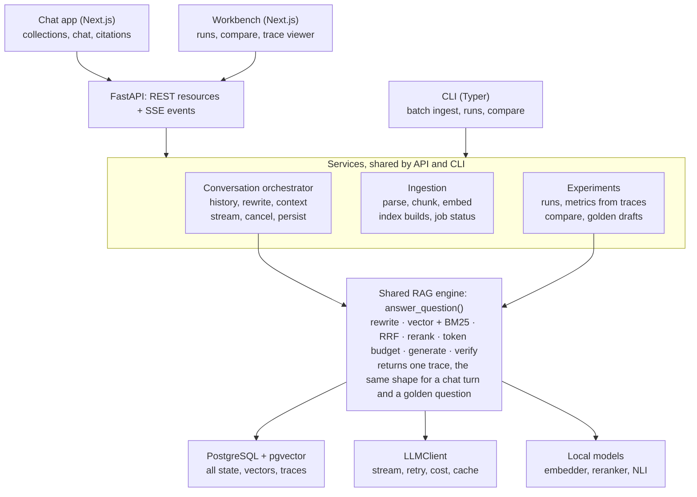

# EvidenceRAG — Product Requirements Document

Oct 30, 2026 · Mehedi Hasan Hridoy

## 1. Product overview

EvidenceRAG is a document intelligence platform with an integrated RAG engineering workbench. Users upload document collections and talk to them through a streaming chat that answers with clickable, verifiable citations. Developers use the same platform to configure retrieval pipelines, evaluate them against ground truth, compare runs, and trace exactly why any answer succeeded or failed.

|  | Document intelligence | RAG workbench |
| --- | --- | --- |
| For | People who want to understand their documents | Developers who want to understand and improve retrieval |
| Core features | Collections, conversational AI, streaming responses, evidence citations, conversation history | Pipeline configuration, evaluation metrics, experiment comparison, execution traces, failure analysis |
| Interface | Next.js chat app | Next.js dashboard + CLI for batch work |

Both sides run on one shared engine: Python, FastAPI, PostgreSQL + pgvector, and one model-provider layer.

### Three principles that are not negotiable

1. **The user experience is real.** Upload documents, start conversations, watch answers stream, click citations, open the source passage, return to old conversations. A working application, not a mockup.
2. **The workbench is real.** Configure pipelines, run evaluations, compare runs, and see exactly why one answer failed. No decorative metrics: every number traces back to stored data.
3. **Both sides share one system.** A question asked in chat runs through the same retrieval and generation code as a golden-set question, and produces the same kind of execution trace. The workbench can inspect any chat answer, and a failed chat question can be promoted into the golden set.

## 2. Objectives and scope

v1 is a single-user, self-hostable platform that does both jobs well on two test corpora, deployed once publicly.

### User objectives

- Create collections and upload Markdown, TXT and text-PDF documents into them.
- Start a conversation scoped to one collection and ask questions in natural language.
- Watch the answer stream in, with citations that open the exact source passage.
- Ask follow-up questions that depend on earlier turns.
- Stop a generation mid-stream, or regenerate an answer.
- Return to past conversations.
- Get a clear "not found in your documents" when the evidence isn't there.

### Developer objectives

- Configure pipelines: chunker, embedding model, retrievers, fusion, reranker, generator.
- Measure retrieval separately from generation, at equal token budgets.
- Evaluate correctness, faithfulness, citation support and abstention.
- Compare two runs per question with honest statistics.
- Open any trace, from an evaluation run or a live chat turn, stage by stage.
- See latency, tokens and cost per stage.
- Promote a real chat question into the golden set.

### Test corpora

| Corpus | Role | Enters |
| --- | --- | --- |
| A: FastAPI documentation (Markdown) | Clean, structured baseline | Phase 1 |
| B: University handbooks and policies (text PDF), DIU if licensing allows | Generalization test: tables, long sections, exceptions | Phase 5 |
| C: Bangla or mixed Bangla-English | Stretch | After v1 |

### Out of scope for v1

- Accounts, sign-up, multi-user and permissions. One local user; the public deployment uses a shared access key and rate limits.
- Message editing and conversation branching. Regenerate creates a new generation of the same message; it doesn't fork the thread.
- Conversation summarization for very long threads. v1 uses a fixed window of recent turns.
- Agents, tool use, web search.
- Fine-tuning any model.
- HTML, DOCX, scanned PDFs, OCR, images.
- Background job queues (Celery, Redis). Ingestion runs as an in-process background task with a status row.
- Approximate vector indexes, Postgres full-text search, LLM claim decomposition (see ADRs).
- Bangla support.
- Kubernetes or multi-instance deployment.

## 3. Engineering objectives and working rules

The project should show three kinds of engineering: product engineering in the frontend, system engineering in the backend, and AI engineering in the workbench. It is built the hard way, for understanding.

### Working rules

1. **Every feature ships three things:** an implementation, tests proving it behaves correctly, and an experiment or observable behaviour showing it's worth having.
2. **Every significant decision gets an ADR before code:** options, choice, trade-off accepted, and what would reopen it (section 12).
3. **Write the core by hand:** chunking, BM25, vector search reference, RRF, metrics, statistics, span resolution, claim and citation logic, the run executor, run comparison, the conversation orchestrator, and the streaming event pipeline. AI tools may write boilerplate and review your code, never write core logic you then read.
4. **No RAG or agent frameworks** (LangChain, LlamaIndex, Haystack, Vercel AI SDK on the backend). Libraries only where reimplementing teaches little: database driver, PDF extraction, tokenizers, model inference, UI components.
5. **Measure before improving.** No retrieval change without a paired comparison against the previous baseline.
6. **Keep an experiment log and a decision log.** Failures included.
7. **If you can't explain it, it isn't done.** Before a phase gate, explain every component out loud: what, why this way, what else was possible, where it breaks.

## 4. Requirements

Each requirement has an ID that commits, tests and ADRs can cite.

### Collections and ingestion

- **ING-1** Create, rename and delete collections. Upload files via API (UI) or a folder via CLI.
- **ING-2** Parsers for Markdown, TXT and text PDF produce normalized text with heading paths. Each parser has a version string.
- **ING-3** Two hand-written chunkers: fixed-size by tokens with overlap; structure-aware (headings first, then size).
- **ING-4** An index build = (document set hash, parser versions, chunker config, embedding model + revision). Builds are immutable. A collection has one active build; others are kept for experiments.
- **ING-5** Embeddings cached by (model, revision, text hash).
- **ING-6** Ingestion runs as a background task with a status (queued, parsing, chunking, embedding, ready, failed) and progress the UI can poll.

### Retrieval

- **RET-1** Exact cosine search in pgvector, with a hand-written NumPy reference; a test asserts identical rankings.
- **RET-2** Hand-written BM25 (tokenizer, inverted index, scoring) with k1, b and tokenizer options.
- **RET-3** Hand-written Reciprocal Rank Fusion over any set of retrievers.
- **RET-4** Optional cross-encoder reranker over the top N.
- **RET-5** Context selection under a token budget.
- **RET-6** Every stage records ranks, scores and latency into the trace.

### Conversation

- **CHAT-1** Conversations belong to one collection and pin the pipeline config used for their answers.
- **CHAT-2** Query rewriting: a follow-up question is rewritten into a standalone query using recent turns before retrieval. The rewrite is a traced stage. First turns skip it.
- **CHAT-3** Context construction: system prompt + last N turns (token-capped) + retrieved chunks + question, with a hard total token budget. Dropped turns are recorded in the trace.
- **CHAT-4** Responses stream over SSE as typed events (section 7).
- **CHAT-5** Stop: cancels the provider call, saves the partial text, marks the generation cancelled.
- **CHAT-6** Regenerate: creates a new generation for the same assistant message; the latest successful one is shown, older ones are kept.
- **CHAT-7** Message history with cursor pagination; conversation list ordered by last activity.
- **CHAT-8** One active generation per conversation; a second send while one is streaming is rejected with 409.

### Answering and verification

- **ANS-1** Every factual sentence ends with chunk citations, e.g. [c12].
- **ANS-2** Abstain with a fixed phrase when evidence is insufficient.
- **ANS-3** Hand-written claim extraction: sentences plus parsed citations.
- **ANS-4** Verifier interface: local NLI (default) and LLM. Verdicts: supported, misattributed, unsupported, uncited.
- **ANS-5** In chat, verification runs after the stream completes and arrives as a final event; the UI marks unsupported sentences. v1 flags, never removes.

### Workbench

- **WB-1** Run: a pipeline config over a golden-set split → one trace per question. Resumable; per-question errors recorded.
- **WB-2** Metrics computed from stored traces; backfillable.
- **WB-3** Compare: per-question wins and losses, paired bootstrap interval, McNemar test.
- **WB-4** Trace viewer for any trace, from a run or from chat.
- **WB-5** Promote a chat turn to a draft golden question for manual labelling.
- **WB-6** Judges via `LLMClient` with fixed rubrics and pinned models.
- **WB-7** Long-context experiment (ADR-013).
- **WB-8** CI runs deterministic retrieval metrics on a fixed subset per PR and fails on regression.

### Platform

- **PLT-1** `LLMClient` with streaming and non-streaming calls, timeouts, retries with backoff (only before the first token), cost logging, response cache, fake for tests.
- **PLT-2** YAML pipeline configs validated by strict schemas and hashed.
- **PLT-3** Structured JSON logs with request, conversation, generation and run IDs.
- **PLT-4** Errors follow one envelope (section 8). No stack traces leave the server.
- **PLT-5** OpenAPI schema generated by FastAPI; frontend types generated from it.

## 5. System architecture

Two user-facing surfaces and a CLI sit on one service layer, and every question, from chat or from evaluation, goes through the same engine call that returns a trace.



The conversation orchestrator and the experiment runner are separate services because a conversation has history, streaming, cancellation and persistence; an evaluation question has none of those. Both end at the same engine.

### Python package layout

One package, layered; imports point down only, enforced by import-linter (ADR-001).

```text
evidencerag/
  domain/          dataclasses: Document, Chunk, EvidenceSpan, Question, Hit, Claim,
                   Trace, Conversation, Message, Generation, Run
  core/            pure, hand-written, no I/O
    chunking/      fixed.py, structure.py
    lexical/       tokenize.py, bm25.py
    vector.py      numpy reference search
    fusion.py      rrf
    context.py     token-budget selection, history window
    claims.py      sentence split, citation parsing
    spans.py       evidence resolution, coverage
    metrics/       retrieval.py, abstention.py
    stats.py       paired bootstrap, mcnemar
    events.py      stream event types and sequencing
  adapters/        all I/O
    parsers/       markdown, text, pdf
    embedders/     sentence-transformers, fake, cache
    rerankers/     cross-encoder
    verifiers/     nli, llm
    llm/           httpx client (stream + sync), fake, cache, pricing
    storage/       pool, repositories, migrations/*.sql, migrate.py
    golden.py      golden-set files
  services/
    engine.py      answer_question() -> Trace
    ingest.py      upload -> documents -> index build (background)
    conversations.py  orchestrator: rewrite, context, stream, cancel, persist
    generations.py    task registry, event buffers, subscriptions
    runner.py      evaluation runs (resumable)
    metrics.py, compare.py, report.py, judges.py, config.py
  interfaces/
    api/           app.py, routers/, schemas/, errors.py, sse.py
    cli.py
web/               Next.js app: app/(chat), app/workbench, lib/api, lib/sse
tests/             unit, integration (real Postgres), api, determinism, e2e (Playwright)
golden/  configs/  experiments/
```

Layer dependency rule: `domain` ← `core` ← `adapters` ← `services` ← `interfaces`. `core` is pure, hand-written and has no I/O.

### Interfaces that earn their place

| Interface | Implementations | Why |
| --- | --- | --- |
| `Chunker` | fixed, structure-aware | Main ingestion experiment axis |
| `Retriever` | vector, BM25, hybrid | Compared in nearly every experiment |
| `Embedder` | sentence-transformers, fake | Fast offline tests |
| `LLMClient` | httpx, fake, caching wrapper; gateway later | Tests, replay, future gateway |
| `Reranker` | cross-encoder, none | On/off axis |
| `Verifier` | NLI, LLM | Compared against each other |

Not interfaces: parsers (a dict of functions), storage (concrete repositories tested against real Postgres), metrics (pure functions).

## 6. Data model

The central decision: a chat request, a message, a generation and a trace are four different things (ADR-014). The trace is the one shape both sides share.

| Entity | What it is | Lifetime |
| --- | --- | --- |
| Conversation | A thread of messages about one collection, with a pinned pipeline config | Long-lived |
| Message | One turn, user or assistant, at a fixed position (`seq`) in the thread | Permanent |
| Generation | One attempt to produce an assistant message. Regenerate makes a new one; stop ends one | One per attempt |
| Trace | What the engine did for one question: rewrite, retrieval stages, context, model calls, verification | One per generation or per eval question |
| Run item | One golden question inside an evaluation run; points to its trace | One per question per run |

So: an assistant message has one or more generations, each generation has exactly one trace, and a run item also has exactly one trace. The trace viewer, metrics and promotion to the golden set work on traces, so they work on chat and evaluation alike.

### Tables

| Table | Key columns | Notes |
| --- | --- | --- |
| collections | id, name, active_build_id | Active build answers chat |
| documents | id, collection_id, filename, content_hash, parser_version, text | Normalized text |
| ingestion_jobs | id, collection_id, status, progress, error | Polled by the UI |
| index_builds | id, collection_id, doc_set_hash, chunker_config, embed_model, embed_revision, config_hash | Immutable |
| chunks | id, build_id, document_id, ord, start_char, end_char, token_count, heading_path, text_hash | Offsets power citations and coverage |
| embeddings | (model, revision, text_hash), vector | Cache shared across builds |
| pipeline_configs | id, name, body (JSONB), config_hash | Named, versioned configs |
| conversations | id, collection_id, pipeline_config_id, title, last_activity_at | |
| messages | id, conversation_id, seq, role, content, active_generation_id | Unique (conversation_id, seq); order by seq, never timestamps |
| generations | id, message_id, trace_id, status, text, finish_reason, error, started_at, finished_at | Status: streaming, completed, cancelled, failed |
| citations | generation_id, sentence_idx, marker, chunk_id, verdict | Filled after verification |
| traces | id, origin (chat or eval), build_id, config_hash, query, rewritten_query, stages (JSONB), schema_version | The shared record |
| llm_calls | id, trace_id, stage, model, prompt_hash, input_tokens, output_tokens, ms, cost_usd, cache_hit | Cost and latency per call |
| llm_cache | key, response | Replay for evaluation runs only |
| runs | id, build_id, config_hash, dataset, dataset_version, split, git_commit, status | |
| run_items | (run_id, question_id), trace_id, status, error | |
| metric_values | (trace_id, metric, metric_version, params_hash), value | Recomputable from traces |
| golden_drafts | id, source_trace_id, question, status | Promoted chat turns awaiting labels |

Golden sets stay as versioned files in git; promoted drafts are exported into them after manual labelling.

### Trace shape

```json
{
  "origin": "chat",
  "query": "what about for students?",
  "stages": {
    "rewrite":  {"output": "What is the retake policy for students?", "llm_call": 412},
    "vector":   {"hits": [{"chunk": "c12", "rank": 1, "score": 0.83}], "ms": 14},
    "bm25":     {"hits": [{"chunk": "c40", "rank": 1, "score": 11.2}], "ms": 3},
    "fused":    {"hits": [{"chunk": "c12", "rank": 1, "score": 0.0325}]},
    "reranked": {"hits": [{"chunk": "c40", "rank": 1, "score": 7.9}], "ms": 910},
    "context":  {"chunks": ["c40", "c12"], "history_turns": 4, "dropped_turns": 2, "tokens": 3100},
    "generate": {"llm_call": 413, "first_token_ms": 640, "total_ms": 4200},
    "verify":   {"claims": [{"sentence": 0, "cites": ["c40"], "verdict": "supported"}], "ms": 120}
  }
}
```

Values show the shape only; they are not results.

## 7. Conversation and streaming lifecycle

A chat turn is a server-owned task that the browser watches, not a request the browser holds open. Closing the tab doesn't kill the answer; only Stop does (ADR-016).

### One turn, step by step

1. **Send.** `POST /conversations/{id}/messages` validates the request, checks no generation is active (else 409), and in one transaction inserts the user message, the assistant message and a generation in status `streaming`. Returns their IDs immediately.
2. **Start the task.** The orchestrator starts as an asyncio task in the server process, keyed by generation ID.
3. **Subscribe.** The browser opens `GET /generations/{id}/events` (SSE). It receives every event already emitted, then live ones.
4. **Rewrite.** If this isn't the first turn, rewrite the question into a standalone query from recent turns.
5. **Retrieve.** Run the conversation's pipeline: retrievers, RRF, reranker, budgeted context selection.
6. **Build context.** System prompt + recent turns within a token cap + chunks + question, under a hard total budget.
7. **Generate.** Stream tokens from the provider through `LLMClient`; emit deltas; buffer the text.
8. **Finish.** Persist the final text, status, finish reason and trace in one transaction.
9. **Verify.** Split into claims, verify against citations, persist citations, emit the verification event.

### Event protocol (application-level)

Each SSE event has a monotonically increasing `seq` per generation, so a reconnecting client resumes with `Last-Event-ID` and misses nothing.

| Event | Payload | When |
| --- | --- | --- |
| `generation.started` | generation_id, message_id | Task begins |
| `retrieval.completed` | chunk IDs with document titles, ms | After context selection |
| `message.delta` | text fragment | Per streamed chunk of tokens |
| `message.completed` | finish_reason, token usage, cost | Text done and persisted |
| `verification.completed` | per-sentence verdicts and citation targets | After verification |
| `generation.cancelled` | partial text length | After Stop |
| `generation.failed` | error code, retryable flag | On unrecoverable error |
| `heartbeat` | none | Every 15 s, keeps proxies from closing the connection |

### Cancellation, failures and disconnects

- **Stop:** `POST /generations/{id}/cancel` cancels the task. The provider stream is closed, partial text is saved, status becomes `cancelled`, and the trace records where it stopped.
- **Provider errors before the first token:** retry with backoff up to a limit, then fail. **After the first token:** never retry silently, since the user has already seen text. Fail with the partial saved; the user can regenerate.
- **Timeouts:** separate limits for time-to-first-token and total generation.
- **Client disconnect:** the task keeps running and persists. Reloading the page shows the finished answer, or reattaches to the stream if it's still running.
- **Server restart mid-generation:** on startup, any generation still `streaming` is marked `failed` with reason `interrupted`. v1 accepts this loss; a durable queue is out of scope.

### How chat and evaluation share the engine

The orchestrator and the evaluation runner both call the same `answer_question(config, build, question, history)` service, which returns a trace. Chat passes real history and streams; evaluation passes no history, doesn't stream, and replays the LLM cache. Everything below that call is identical code.

## 8. API contracts

REST resources plus one SSE stream per generation, all under `/api/v1`. Routers stay thin: validate, call a service, map the result (ADR-001).

| Method | Path | Purpose |
| --- | --- | --- |
| POST | /collections | Create a collection |
| GET | /collections | List collections |
| POST | /collections/{id}/documents | Upload files (multipart); starts an ingestion job |
| GET | /ingestion-jobs/{id} | Job status and progress |
| GET | /documents/{id}/passages?start=&end= | Source text around a citation, for the preview pane |
| POST | /conversations | Create, with collection_id and optional pipeline_config_id |
| GET | /conversations?cursor= | List, newest activity first |
| GET | /conversations/{id}/messages?before_seq= | Message history, paginated by seq |
| POST | /conversations/{id}/messages | Send a question; returns message and generation IDs |
| GET | /generations/{id}/events | SSE stream; supports Last-Event-ID |
| POST | /generations/{id}/cancel | Stop |
| POST | /messages/{id}/regenerate | New generation for an assistant message |
| GET | /traces/{id} | Full trace for the viewer |
| POST | /traces/{id}/promote | Create a golden draft from a chat turn |
| GET, POST | /pipeline-configs | List and create configs |
| POST | /runs | Start an evaluation run (background task) |
| GET | /runs, /runs/{id} | List runs, run summary with metrics |
| GET | /runs/{id}/items?cursor= | Per-question results |
| GET | /comparisons?a=&b= | Paired comparison of two runs |

### Conventions

- **Errors:** one envelope everywhere: `{"error": {"code": "generation_in_progress", "message": "...", "retryable": false}}`, with matching HTTP status (400 validation, 404, 409 conflict, 422, 502 provider error, 503 overloaded).
- **Pagination:** cursor-based, never offset, so new messages don't shift pages.
- **Idempotency:** sending a message accepts an `Idempotency-Key` header so a double-click doesn't ask twice.
- **Auth:** none locally. The public deployment sits behind a shared access key in a header and per-IP rate limits. Real accounts are out of scope.
- **Schema:** FastAPI's OpenAPI output is the contract; frontend TypeScript types are generated from it in CI, so a breaking change fails the frontend build.

## 9. Frontend

One Next.js app with two areas: the chat app at `/`, the workbench at `/workbench`. It is a client of the FastAPI API and holds no business logic (ADR-017).

### Routes

| Route | Screen |
| --- | --- |
| /collections | List, create, upload with ingestion progress |
| /chat/[conversationId] | Sidebar (collections, conversations), message thread, composer, source pane |
| /workbench/runs | Runs with headline metrics |
| /workbench/runs/[id] | Run summary, metrics by question type, per-question table |
| /workbench/compare?a=&b= | Paired comparison: interval, wins and losses, regressed questions |
| /workbench/traces/[id] | Trace viewer: every stage, hits, scores, context, tokens, cost |
| /workbench/configs | Pipeline configs |

### Chat behaviour that must work

- Streaming text rendered as Markdown, including code blocks, without re-rendering the whole thread per token.
- Citation markers become clickable chips; clicking opens the passage in the source pane, highlighted.
- Sentences marked unsupported after verification arrive.
- Stop and Regenerate; switching between generations of one message.
- Loading, empty, error and "not found in your documents" states.
- Reload mid-stream reattaches to the running generation.
- Every assistant message links to its trace in the workbench.

### Frontend decisions

- **Server state:** TanStack Query for REST data (caching, refetching, pagination).
- **Streaming:** a hand-written SSE client over `fetch` and `ReadableStream`, not the browser's `EventSource`, so it can send the access-key header and handle `Last-Event-ID` itself. This is the frontend's equivalent of the hand-written core.
- **UI components:** Tailwind + shadcn/ui, so time goes into behaviour, not styling.
- **Charts in the workbench:** a small charting library; the numbers always come from API data, never computed in the browser.

## 10. Evaluation contract

This section is locked before any pipeline code is written. If a later finding forces a change, the golden-set version or metric version is bumped and old runs are recomputed from their traces.

### Golden set

- **EVAL-1 Evidence is quoted text, not offsets.** Each question stores the exact evidence passages as text plus the source document. At load time they are resolved to character offsets in the current parse (exact match, then whitespace-normalized match). If a passage can't be resolved, loading fails loudly. Why: offsets break whenever a parser changes; quoted text survives (ADR-007).
- **EVAL-2 Size and mix.** Corpus A: 60 questions. Corpus B: 50. Each corpus: at least 15% unanswerable, at least 20% deliberately paraphrased (written without reusing the documents' wording), the rest split across direct, multi-passage, and condition/exception questions. Every question is tagged by type, and results are reported by type.
- **EVAL-3 Dev and test splits.** 60% dev, 40% test, assigned by a hash of the question ID and stratified by type. All tuning uses dev. Test is run only at milestone gates. Why: tuning and reporting on the same questions is overfitting to your own exam.
- **EVAL-4 Versioning.** Files live in `golden/<corpus>/v<N>.jsonl`. Any edit bumps the version. Runs record the version and split.

```json
{
  "id": "fa-017",
  "question": "How do you declare an optional query parameter?",
  "type": "direct",
  "paraphrased": false,
  "answerable": true,
  "reference_answer": "Give it a default of None, for example q: str | None = None.",
  "evidence": [
    {"doc": "tutorial/query-params.md", "text": "<exact passage copied from the document>"}
  ]
}
```

### Retrieval metrics

- **EVAL-5 Coverage rule.** An evidence span counts as retrieved if at least θ of its characters fall inside the retrieved chunks. θ = 0.5 by default; reports also show θ = 0.3 and 0.7 so the conclusion's sensitivity to the rule is visible.
- **EVAL-6 Equal token budget.** Chunking strategies are compared at the same budget B of retrieved tokens (default 2,000; also 500, 1,000, 4,000), never at the same k. Why: at equal k, bigger chunks trivially cover more text, so recall rewards chunk size, not retrieval quality (ADR-012).

$$
\mathrm{Recall}@B = \frac{|\{\, s \in E : \mathrm{cov}(s, H_B) \ge \theta \,\}|}{|E|}
$$

Here E is the question's evidence spans, H_B the hits within budget B, and cov the fraction of a span's characters inside those hits. Hit@B is 1 if any span is covered. MRR uses the rank of the first hit that covers any span, reported at k = 10 to measure ranking quality. Unanswerable questions are excluded from retrieval metrics and scored on abstention.

### Answer and citation metrics

- **EVAL-7 Judges.** Correctness: correct / partially correct / incorrect against the reference. Faithfulness: is every claim supported by the retrieved context (yes / no). Fixed rubric, pinned judge model, ideally a different model family from the generator.
- **EVAL-8 Judge validation.** Before any judge number is trusted, hand-label 60 answers and report Cohen's kappa, not raw agreement. Target kappa ≥ 0.6. Re-validate whenever the judge prompt or model changes.
- **EVAL-9 Verifier validation.** Hand-label 100 claims; report the verifier's precision and recall per outcome. An unmeasured verifier is just another unverified model.
- **EVAL-10 Abstention.** Report precision and recall of abstaining, using the unanswerable questions as positives.

### Comparing runs

- **EVAL-11 Paired comparison only.** Two runs are compared on the same questions. Report per-question wins, losses and ties; a 95% paired bootstrap interval (10,000 resamples) on the metric difference; McNemar's test on Hit@B. Every number is reported with its n.
- **EVAL-12 No claims inside the noise.** With 36 dev questions, one question is about 2.8 points. A difference whose interval includes zero is reported as "no detectable difference", not as an improvement.

### Reproducibility

- **EVAL-13 Deterministic stages** (parsing, chunking, embedding with a pinned model revision, BM25, exact vector search, RRF, reranking, retrieval metrics) must reproduce bit-for-bit. A test runs the same retrieval config twice and asserts identical traces.
- **EVAL-14 Stochastic stages** (generation, LLM verifier, judges) go through a response cache keyed by (model ID, prompt hash, parameters). Re-running a run replays the cache and reproduces its numbers exactly. To measure variance, a flag bypasses the cache and runs a subset N times.

## 11. Tech stack

Every tool was chosen over named alternatives, with a cost accepted on purpose. If you can't say why it beat the alternative, you don't own the choice yet.

### Backend and engine

| Area | Choice | Chosen over | Because | Cost we accept |
| --- | --- | --- | --- | --- |
| Language | Python 3.12 | Go, TypeScript | ML ecosystem and model inference live here | Slower CPU loops; the GIL |
| Packaging | uv + pyproject, lockfile committed | pip + venv, Poetry | Fast, one tool, reproducible | Younger tool |
| API framework | FastAPI + uvicorn | Flask, Django, Litestar | Async-native, typed request models, OpenAPI for free | Async bugs are subtle; you must understand the event loop |
| Streaming transport | Server-Sent Events | WebSockets, long polling | One-way server-to-client is all chat needs; plain HTTP; built-in resume via Last-Event-ID | No client-to-server channel; Stop is a separate POST |
| Background work | asyncio tasks in-process + status rows | Celery, RQ, Arq + Redis | No extra infrastructure for one instance; you see exactly how tasks run | Tasks die with the process (ADR-016) |
| Domain types | Frozen dataclasses | Pydantic everywhere | Core stays dependency-free | Manual validation inside the core |
| API and config schemas | Pydantic v2, `extra="forbid"` | Manual parsing, attrs | Strict validation at the edges | Runtime cost at boundaries |
| CLI | Typer | argparse, Click | Commands from type hints | Extra dependency |
| Database | PostgreSQL 16 + pgvector | SQLite + sqlite-vec, Qdrant | ADR-003 | A server even locally |
| DB access | psycopg 3 async, plain SQL, connection pool | SQLAlchemy, asyncpg | ADR-011; psycopg serves both sync CLI and async API | Hand-written mapping |
| Migrations | Numbered `.sql` files + a small runner you write | Alembic | Teaches what migration tools do | No autogenerate or downgrades |
| Embeddings | sentence-transformers, `multilingual-e5-small`, pinned revision | Hosted embedding APIs | Free, local, deterministic | Lower quality; needs query/passage prefixes |
| Chunk tokenizer | The embedding model's tokenizer | tiktoken, whitespace | Sizes in the units the model sees | Differs from generator tokens |
| Reranker | Local cross-encoder (`bge-reranker-base`) | None, hosted rerankers | Free; clean on/off experiment | About a second per query on CPU |
| Claim verifier | Local NLI cross-encoder | LLM-only | Deterministic and free | 512-token premise limit |
| PDF text | pdfplumber | pypdf, PyMuPDF | MIT-licensed, layout-aware text extraction that satisfies v1's text-PDF requirements; see ADR-0019 | Lower throughput than native-library alternatives; measure extraction time during ingestion |
| Markdown | markdown-it-py | Regex | A real parser | Dependency |
| LLM calls | httpx against OpenAI-compatible endpoints, streaming | Vendor SDKs | One client for every provider; you learn streaming, timeouts and retries | You write retries and error mapping |
| CPU-bound model calls in the API | Run in a thread pool from async handlers | Blocking the event loop; separate model service | Keeps streams responsive | Thread-pool sizing to understand |
| Statistics | NumPy, hand-written bootstrap and McNemar | SciPy, statsmodels | Owning the method; SciPy only as a test oracle | Risk of subtle errors, caught by tests |
| Testing | pytest, pytest-asyncio, Hypothesis, httpx test client | unittest | Property tests for invariants; async endpoint tests | Learning curve |
| Quality | ruff, mypy (strict on core), import-linter | pylint, pyright | Dependency rule enforced in CI | Annotation overhead |
| Logging | structlog, JSON | stdlib alone | Request, generation and run IDs on every line | Dependency |

### Frontend

| Area | Choice | Chosen over | Because | Cost we accept |
| --- | --- | --- | --- | --- |
| Framework | Next.js (App Router) + TypeScript | Vite + React SPA, SvelteKit | Routing, layouts, industry standard for AI apps | App Router complexity; server components you mostly won't need |
| Server state | TanStack Query | Redux, SWR, hand-rolled fetch | Caching, pagination, invalidation solved well | Another mental model |
| SSE client | Hand-written over fetch + ReadableStream | EventSource, Vercel AI SDK | Custom headers, resume logic, and you learn the wire format | More code to test |
| API types | Generated from OpenAPI (openapi-typescript) | Hand-written types | Backend changes break the build, not production | Codegen step in CI |
| Styling and components | Tailwind + shadcn/ui | Material UI, plain CSS | Fast, owned component code | Utility-class verbosity |
| Markdown rendering | react-markdown + syntax highlighting | Hand-rolled | Correct Markdown is not the learning goal | Re-render cost during streaming to manage |
| Tests | Vitest for logic, Playwright for the chat flow end to end | Jest, Cypress | Fast unit tests; real browser for streaming | E2E tests are slower |

### Runtime and delivery

| Area | Choice | Chosen over | Because | Cost we accept |
| --- | --- | --- | --- | --- |
| Local dev | Docker Compose for Postgres; API and web run natively | Everything in containers | Fast edit-run loop | Environment drift, managed by uv and the lockfile |
| Deployment | One small VM: Compose with API, web, Postgres, Caddy for TLS | Kubernetes, serverless | One instance fits ADR-016; you understand every layer | Single point of failure |
| CI | GitHub Actions | GitLab CI | Free for public repos | Minor lock-in |

### Questions you must be able to answer

- Why SSE over WebSockets for chat, and when would WebSockets be the right call?
- What happens to the event loop if you run a cross-encoder directly in an async handler?
- Why does a reconnecting stream need event sequence numbers?
- Why a bi-encoder for retrieval and a cross-encoder for reranking?
- What does pgvector do for an exact search with no index, and how does it scale?
- Why might two identical temperature-0 API calls return different text?

## 12. Architectural decision records

Eighteen decisions are locked for v1. Each states what was rejected and why; the "revisit if" line says what evidence would reopen it. In the repository, each ADR lives in its own file under `docs/adr/`.

### ADR-001 Modular monolith with an inward dependency rule

- **Options:** microservices; one package with subpackages; a flat script collection.
- **Decision:** one installable package. Layers `domain` ← `core` ← `adapters` ← `services` ← `interfaces`; imports only point left. Enforced by import-linter in CI.
- **Why:** one developer, one process, no network boundaries needed. The layering gives testability without the operational cost of services. `core` has no I/O, so its algorithms are tested with plain inputs and no mocks.
- **Cost:** discipline is needed to keep orchestration out of `core`.
- **Revisit if:** a component needs independent scaling or deployment.

### ADR-002 FastAPI and CLI from the start, sharing one service layer (revised)

- **Options:** CLI-first with the API at launch (the earlier decision); API-only; both from the start.
- **Decision:** both from phase 1. The API serves the app and dashboard; the CLI serves batch ingestion, runs and comparisons. Both call the same `services` functions.
- **Why it changed:** the product now has a real user-facing app, and learning the backend of an AI application (async, streaming, cancellation, persistence) is a primary goal, not a deployment detail.
- **Cost:** more surface area early; async correctness has to be learned up front.
- **Revisit if:** never for v1.

### ADR-003 PostgreSQL + pgvector as the only datastore

- **Options:** SQLite + sqlite-vec; Postgres + pgvector; a dedicated vector DB (Qdrant, Chroma) beside a relational DB.
- **Decision:** Postgres + pgvector.
- **Why:** documents, chunks, vectors, runs and traces in one transactional store; JSONB for traces; vectors joinable with metadata in one query; the same database serves the deployment. A second store means keeping two systems consistent for no gain at this scale.
- **Cost:** a server process even locally; fewer vector-specific features than Qdrant.
- **Revisit if:** corpora reach millions of chunks or filtering needs outgrow SQL.

### ADR-004 Exact vector search for evaluation, with a NumPy reference

- **Options:** HNSW or IVFFlat index; exact scan.
- **Decision:** no ANN index in v1. Exact cosine search, and a NumPy brute-force implementation that a test checks against pgvector.
- **Why:** approximate indexes trade recall for speed and their results depend on build parameters, which breaks deterministic evaluation. At tens of thousands of chunks, an exact scan is fast enough.
- **Cost:** linear scan time per query.
- **Revisit if:** p95 retrieval latency exceeds about 200 ms. Then add HNSW and measure its recall loss against exact search as its own experiment.

### ADR-005 BM25 implemented in Python, in memory

- **Options:** Postgres full-text search (`ts_rank`); a library (`rank_bm25`); ParadeDB; own implementation.
- **Decision:** own inverted index and Okapi BM25 scoring, built from the chunks of an index build at startup.
- **Why:** `ts_rank` isn't BM25 (no IDF in the same form, different length normalization). Writing BM25 is a core learning goal, and at this scale an in-memory index builds in seconds.
- **Cost:** rebuilt per process; memory proportional to corpus; not shared across processes.
- **Revisit if:** build time or memory becomes a problem; then persist postings in Postgres.

### ADR-006 Fuse rankings with Reciprocal Rank Fusion

- **Options:** add normalized scores; weighted score sum; RRF.
- **Decision:** RRF with k = 60 by default.

$$
\mathrm{RRF}(d) = \sum_{r \in R} \frac{1}{k + \mathrm{rank}_r(d)}
$$

- **Why:** cosine similarity and BM25 scores live on different, query-dependent scales, so adding them lets whichever scale is larger dominate. Ranks are comparable across retrievers and need no calibration. k damps the gap between rank 1 and rank 2.
- **Cost:** discards score magnitudes, so a retriever that is very confident is treated the same as one barely ranking a document first.
- **Revisit if:** a tuned weighted combination beats RRF on dev with an interval excluding zero.

### ADR-007 Evidence stored as quoted text, resolved at load time

- **Options:** chunk IDs; character offsets; quoted text.
- **Decision:** quoted text plus document, resolved to offsets when loading the golden set.
- **Why:** chunk IDs change with every chunker; offsets change with every parser fix. Quoted text survives both.
- **Cost:** resolution can fail after a parser change; the loader must fail loudly when it does.

### ADR-008 Claims are sentences; a local NLI model verifies them

- **Options:** LLM claim decomposition; sentence-level claims. LLM verifier; NLI verifier.
- **Decision:** sentence-level claims with required citations. NLI cross-encoder as the default verifier; LLM verifier as the comparison.
- **Why:** sentences are deterministic and testable; LLM decomposition adds an unvalidated model in front of the thing being measured. NLI is free, local and deterministic.
- **Cost:** compound sentences hide several claims; NLI has a 512-token premise limit.
- **Revisit if:** the verifier-validation set shows compound sentences cause most errors.

### ADR-009 Two reproducibility classes and a response cache

- **Options:** assume temperature 0 is deterministic; cache responses; run everything N times.
- **Decision:** deterministic stages must reproduce exactly. Stochastic stages go through a response cache so runs replay; variance is measured explicitly on a subset.
- **Why:** hosted models are not bit-deterministic even at temperature 0, and providers update models. Pretending otherwise makes "reproducible" a false claim.
- **Cost:** cache storage; a replayed run can't detect provider drift (the variance mode can).

### ADR-010 Store traces; compute metrics afterwards

- **Options:** compute metrics during the run; store traces and compute later.
- **Decision:** runs store full per-question traces; metrics are a separate step over stored traces.
- **Why:** new or fixed metrics can be backfilled over every old run without re-executing it. Every feature reports through the same record, which is what makes this a workbench.
- **Cost:** more storage; JSONB traces need a stable schema version.

### ADR-011 Plain SQL with psycopg 3, no ORM

- **Options:** SQLAlchemy ORM; SQLAlchemy Core; plain SQL.
- **Decision:** plain SQL in small repository modules.
- **Why:** the important queries (vector search, bulk inserts with COPY, JSONB) are SQL-shaped; an ORM would hide them. You learn the database, not the ORM.
- **Cost:** hand-written row mapping; no ORM conveniences.
- **Revisit if:** query code turns into heavy duplication.

### ADR-012 Compare chunking strategies at equal token budget

- **Options:** equal k; equal token budget.
- **Decision:** equal budget (EVAL-6).
- **Why:** at equal k, bigger chunks cover more text, so recall measures chunk size, not retrieval quality.
- **Cost:** a budget-filling step in retrieval, and results that depend on the budget, reported at several values.

### ADR-013 Long context is a controlled experiment, not a product mode

- **Options:** a "stuff everything" query mode; a separate experiment.
- **Decision:** an experiment script over corpus subsets of fixed sizes, each containing the evidence for a fixed question subset, using the same generator, prompt and grader as RAG.
- **Why:** "send as much as fits" is an unfair baseline that fails by truncation, not by reasoning. The honest output is a curve of accuracy, cost and latency against corpus size.
- **Cost:** large token spend; estimate it before running (50 questions × 400k tokens is 20M input tokens).

### ADR-014 Message, generation and trace are separate entities

- **Options:** one row per assistant reply holding text and trace; message + generation; message + generation + trace.
- **Decision:** all three, as in section 6.
- **Why:** a message is a position in a conversation; a generation is one attempt to fill it (regenerate, stop, fail); a trace is what the engine did, and it has the same shape for chat and evaluation. Merging them makes regenerate overwrite history and ties the workbench to chat tables.
- **Cost:** more joins; the UI must choose which generation to show.

### ADR-015 Follow-up questions are rewritten before retrieval

- **Options:** retrieve with the raw question; retrieve with the question plus recent history concatenated; rewrite into a standalone query with an LLM.
- **Decision:** LLM rewrite on turns after the first, recorded as a trace stage.
- **Why:** "what about for students?" retrieves nothing useful alone; concatenating history drags old topics into the search. A rewrite is explicit, inspectable, and can be evaluated with its own golden follow-up questions.
- **Cost:** an extra model call per follow-up (latency and money); a bad rewrite poisons retrieval, so it must be visible in the trace.
- **Revisit if:** the rewrite's latency dominates time-to-first-token.

### ADR-016 Generations are server-owned tasks, decoupled from the connection

- **Options:** generate inside the SSE request handler; in-process background task with subscribers; durable job queue with workers.
- **Decision:** an in-process asyncio task per generation, with an in-memory event buffer that SSE connections subscribe to.
- **Why:** a closed tab or flaky network shouldn't kill or duplicate an answer; Stop must be an explicit action. A queue (Redis, Celery) solves durability that v1 doesn't need on one instance.
- **Cost:** generations die on server restart (marked `interrupted`); doesn't scale past one instance without a shared broker.
- **Revisit if:** more than one API instance is needed.

### ADR-017 The frontend is a pure API client

- **Options:** Next.js API routes as a backend-for-frontend; Next.js calling FastAPI directly from the browser.
- **Decision:** the browser calls FastAPI directly; Next.js does rendering and routing only.
- **Why:** one backend, one place for logic and auth, and the API stays a real product surface the CLI and tests also use. A BFF layer would duplicate logic in TypeScript.
- **Cost:** CORS configuration; the public access key is visible to the browser, so it's a soft gate backed by rate limits, not security.

### ADR-018 Streaming uses sequenced, typed SSE events

- **Options:** raw token stream; WebSockets; typed SSE events with sequence numbers.
- **Decision:** typed SSE events (section 7), each with a per-generation sequence number, replayable from the in-memory buffer while the generation runs.
- **Why:** the UI needs more than tokens (retrieval done, citations, verification, failure). Sequence numbers make reconnects lossless. SSE is plain HTTP, works through proxies, and fits one-way traffic.
- **Cost:** events after completion aren't replayable from memory; a client that reconnects late reads the finished message from REST instead.
- **Revisit if:** a feature needs client-to-server messages mid-stream.

## 13. Roadmap

v1 takes about 24 weeks at 10–12 hours a week, alternating between the engine track and the app track. A working chat exists by week 9; everything after that deepens either side behind a working product.

```mermaid
flowchart TD
    p1["<b>Wk 1–3 · Foundations</b> (both)<br/>Repo, Postgres, migrations, parsers, FastAPI skeleton<br/><i>Know: ASGI, transactions, why quoted evidence spans</i><br/>Gate: golden set A frozen; upload works via API"]
    p2["<b>Wk 4–6 · Baseline engine</b> (engine)<br/>Fixed chunker, embeddings, exact search, runner, CLI<br/><i>Know: cosine similarity, bi-encoders, Recall@B</i><br/>Gate: baseline reproduces bit-for-bit"]
    p3["<b>Wk 7–9 · Chat vertical slice</b> (app)<br/>Streaming LLMClient, orchestrator, SSE, stop, chat UI<br/><i>Know: async generators, SSE wire format, cancellation</i><br/>Gate: ask, stream, cite, persist, reload all work"]
    p4["<b>Wk 10–12 · Retrieval experiments</b> (engine)<br/>BM25, RRF, structure chunker, reranker, stats, CI gate<br/><i>Know: IDF, rank fusion, cross-encoders, bootstrap</i><br/>Gate: every change has a paired comparison"]
    p5["<b>Wk 13–15 · Conversation depth</b> (app)<br/>Query rewrite, history window, regenerate, reconnect<br/><i>Know: context budgets, event replay, idempotency</i><br/>Gate: rewrite measured; cancel and disconnect tested"]
    p6["<b>Wk 16–18 · Answer quality</b> (engine)<br/>Abstention, claims, NLI verifier, judges, corpus B<br/><i>Know: entailment, judge bias, Cohen's kappa</i><br/>Gate: judge kappa 0.6+; corpus B results in"]
    p7["<b>Wk 19–21 · Workbench UI</b> (both)<br/>Runs, compare, trace viewer, promote; long-context test<br/><i>Know: what each chart claims, context-length cost</i><br/>Gate: any chat answer traced; crossover curve done"]
    p8["<b>Wk 22–24 · Launch</b> (both)<br/>Deploy, access key, rate limits, test report, write-up<br/><i>Know: TLS, reverse proxies, abuse limits</i><br/>Gate: public instance live; write-up published"]
    p1 --> p2 --> p3 --> p4 --> p5 --> p6 --> p7 --> p8
```



Each gate must pass, and its "Know" topics be explained out loud, before the next phase. If a phase slips, cut stretch items, never a gate. The chat slice in phase 3 deliberately uses the naive baseline retrieval; retrieval improves behind it from phase 4, with evaluation proving each step.

### Week 1, concretely

- [ ] Repo: uv project, ruff, mypy, pytest, import-linter, GitHub Actions running all four.
- [ ] Docker Compose with Postgres 16 + pgvector; write the migration runner and the first migration.
- [ ] FastAPI app with `/health`, the error envelope, structured logging and a request ID middleware.
- [ ] Domain dataclasses for Document, Chunk, EvidenceSpan, Question.
- [ ] Download the FastAPI docs at a pinned commit; write the Markdown parser with tests.
- [ ] Write the first 20 golden questions by hand.
- [ ] Write ADR-019 onward for anything decided this week that isn't already in section 12.

## 14. Risks and open questions

The two biggest risks: the frontend quietly consuming the time meant for retrieval and evaluation, and the project stalling because it's twice the size it was.

| Risk | Mitigation |
| --- | --- |
| Scope: about 24 weeks at 10–12 hours/week alongside a job | Every phase ends with something working; stretch items cut first, gates never |
| Frontend polish eats engine time | shadcn/ui components; UI work capped per phase; workbench screens stay plain tables and simple charts |
| Building features without understanding them | Working rule 7: explain every component before each gate |
| Using AI tools for core logic, then not owning it | Hand-written list in section 3; AI only reviews |
| Async bugs: blocked event loop, leaked tasks, lost cancellations | Model inference in a thread pool; tests for cancel and disconnect; structured logs per generation |
| Small golden sets produce noise | Paired comparisons with intervals (EVAL-11, EVAL-12) |
| Overfitting to the golden set | Dev/test split; test only at gates |
| Unreliable judges or verifier | Validated against hand labels (EVAL-8, EVAL-9) |
| API cost on a small budget | Local embeddings, reranker and verifier; cache for evaluation; judges off in CI; cost estimate before the long-context experiment |
| Public deployment abuse | Access key, per-IP rate limits, upload size limits, spend cap at the provider |

